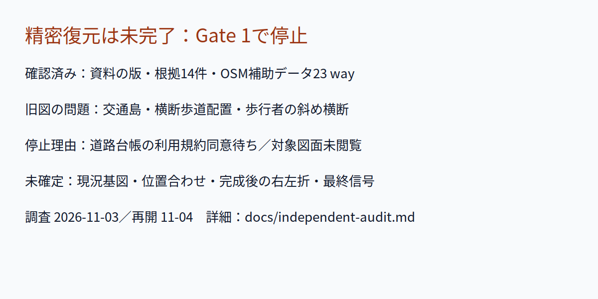

# 二ツ橋1号交差点：独立検証

**精密復元は未完了です。Gate 1（道路台帳による現況基図）で停止しています。**

既存の完成模式図と信号模式図には原資料との不一致があり、撤回通知へ置換しました。現況・完成後の通行案内として使わないでください。

- [独立監査・停止理由・再開条件](docs/independent-audit.md)
- [独立再検証（2026-11-04、公式原典の再取得による照合）](docs/muse-independent-verification.md)
- [道路台帳の閲覧結果と制約](docs/road-ledger-review.md)
- [資料の問い合わせ案（未送信）](docs/source-request.md)
- [道路・構造物の候補ID台帳](docs/road-inventory.md)
- [方向別動線と信号の確認状況](docs/movement-review.md)
- [資料登録簿](sources/source-register.md) / [調査計画](docs/investigation-plan.md)
- [検証状況ビュー](docs/generated/index.html)



## 到達点

本線のアンダーパス、地上道路、鉄道、歩行者地下通路を混同しないためのOSM補助確認を実施しました。layerは相対順序で、全域が一律の三層構造とは確定できません。

公式資料は駅側道路と新設道路の接続、交通島、横断歩道・信号の整備方針を示します。最新の詳細平面図、最終の右左折規制・信号現示は未取得です。2018年検討案は歴史資料として扱います。

2026年11月4日に利用規約へ同意し、対象道路台帳平面図を閲覧しました。ただし、対象局所の測量・補正時点と精密座標基図は未確認です。公開計画図は内部改定が2024年10月で、第7回変更内容も今回未取得。位置合わせの基準点・残差は未計測です。

## 再生成・検証

Python 3.12、Cairo、Noto Sans CJK JPを使用します。

```sh
pip install -r requirements.txt
python scripts/validate_evidence.py
python -m unittest discover -s tests -v
python scripts/build_audit.py
python scripts/inspect_svg.py docs/generated/*.svg
python scripts/validate_evidence.py --check-generated
```

`validate_evidence.py --require-complete` は現在、終了コード2です。通常CIの成功は証拠記録と撤回措置の整合性を意味し、道路復元完了の判定ではありません。CIは生成物を自動コミットしません。

原資料PDF・GSIタイル・道路台帳のトレースは公開保存していません。OSM補助データ23 wayは投稿者アカウント情報なしで固定保存しています。

© OpenStreetMap contributors。[OSMデータ](data/osm-corroboration.json)は[ODbL 1.0](https://opendatacommons.org/licenses/odbl/1-0/)に従います。[公開方針](PUBLIC_DATA_POLICY.md) / [旧成果物の扱い](docs/archive/README.md)。
